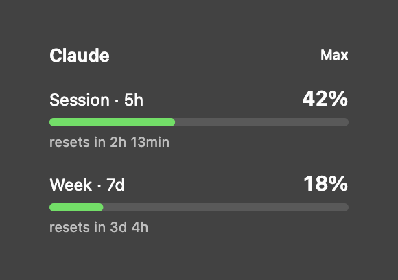

# Simple Claude Usage

A tiny macOS menu bar app that shows your Claude subscription usage: plan, 5-hour session %, and weekly %.

<p align="center"></p>

## Download

**[⬇️ Download the latest .dmg](https://github.com/nthnbch/simple-claude-usage/releases/latest)** → open it, drag *Claude Usage* onto *Applications*, launch it. (First launch: right-click > Open, the app is not notarized.)

## Why

I wanted something simple, safe and personal: no risk, no account to hand over, no need to open the official Claude app just to check how much I have left. One glance at the menu bar, that's all.

Languages: English, Français, Deutsch, Italiano, Русский, Español (follows the system language).

- Hover or click the menu bar icon to see details. The menu bar shows the 5h percentage.
- One Swift file (~250 lines), no dependencies, no Dock icon.
- Refreshes every 5 minutes (and when you open the menu, at most once a minute). Pure AppKit, no SwiftUI, to keep memory and battery use minimal.

## Prerequisite: Claude Code must be installed

This app has no login of its own. It reuses the session of **Claude Code** (the `claude` command-line tool), so Claude Code must be installed and logged in at least once (`npm install -g @anthropic-ai/claude-code`, then run `claude`). Claude Desktop alone is not enough, and not needed.

## Build from source

Requires macOS 13+, Xcode command line tools, and **Claude Code (the CLI) logged in once**. The Claude Desktop app is *not* required: this app only reads the credentials Claude Code stores in your keychain.

```sh
git clone https://github.com/nthnbch/simple-claude-usage.git
cd simple-claude-usage
./build.sh
open build/ClaudeUsage.app
```

To make a .dmg: `./make-dmg.sh`. To keep it permanently, move it to `/Applications` and add it to Login Items.

## Safety

- Reads the OAuth token from Claude Code's existing keychain item (macOS asks permission once; choose "Always Allow").
- The token is only sent to `api.anthropic.com`. It is never stored, logged, or refreshed by this app. The token lasts a few hours and is renewed by Claude Code itself when you use it; if it has expired, the app tells you and resumes as soon as Claude Code has renewed it. (Refreshing it ourselves could invalidate your Claude Code login, so we deliberately don't.)
- Uses an undocumented Anthropic endpoint (`/api/oauth/usage`), which may change.

## License

MIT
